<div align="center">

# Ibili

**Bilibili on iPad, redesigned from scratch.**

[](https://github.com/ElioXBlaze/Ibili/releases)
[](LICENSE)
[](#install)
[](#nine-ui-languages)
[](#install)

**[← 中文](README.md)**　·　English　·　by **Xi/ElioXBlaze**　·　QQ group **1134860332**

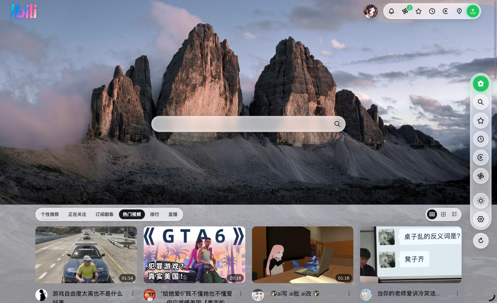

</div>

Desktop Bilibili on the web has every feature and a real keyboard. The mobile app has gestures that feel right and an interface that looks right. **Ibili joins the two** — it keeps the whole web feature set, then gives it a modern interface and app-grade touch gestures.

It is the successor to **BilibiliPlus** (whose player layer is internally BiliPad v2.5.1; the original project is paused), merged with the archived [BewlyBewly](https://github.com/BewlyBewly/BewlyBewly) redesign layer, and iterated from 3.0.0 to **3.1.0**. One file, one install, and a language picker the first time you open it.

---

## Decide in 30 seconds

| | | |
|---|---|---|
| **41** speed steps, 0.0312×–32× | **9** UI languages | **14** shortcuts |
| **No system fullscreen**, danmaku intact | **1 file**, no build, no deps | **0** telemetry |

Videos you dislike disappear in one tap. Videos you want are always within reach. Settings are not a floating panel — they **live inside the site's own menu**.

---

## The good stuff, first

### ① Playback: full keyboard, full speed range, danmaku intact

Autoplay tries with sound first, falls back to muted only when the browser refuses, and quietly restores audio on your first gesture. Volume is remembered. **41 extended speed steps** (full range on keyboard, touch hold capped at 6×), with hold, lock, step-through and memory.

`F` forwards to **Bilibili's own web-fullscreen button only**. System fullscreen / AVKit paths are intercepted and redirected, because that layer drops danmaku, the control bar and every long-press gesture. `Shift+F` adjusts picture fill: crop black bars in landscape, keep the whole frame (and faces) in portrait.

### ② Touch: feels like an app, not a page

All gestures live in the web layer — the video is never handed to the native player: long-press for temporary 2×, hold to lock, slide up/down while holding to step or unlock, left half for visual brightness, right half for page volume, horizontal swipes yield to Bilibili's native seek. The 0–100% glass HUD inherits the theme, blur and opacity of the redesign layer instead of being a white line.

### ③ You control the feed

Bottom-right **×** = one-tap "Not interested": it runs the redesign layer's three-dot menu, reports the official dislike, and the card immediately becomes "Video removed".
Bottom-left **＋** = your local blocklist, resolved by uploader name (never stores "unknown uploader"), and **only actually hides cards when Study Mode is on**. Two buttons, one visual language, two separate jobs.

Plus `b` one-tap triple (auto-substitutes like/favorite when coins run out), `g` Study Mode zone filtering, and `r` refresh that **verifies the cards actually changed** before reporting success.

### ④ A full redesign — settings included

Home, search, zones, dynamics, spaces, Watch Later and favorites are all re-laid-out: top bar and Dock, card grid, radius and tracking, wallpaper and glass, startup animation. The top bar keeps a single transparent `ibili` gradient mark: **tap for 34 official zones, double-tap to go home**.

The important part is consistency. Ibili's settings panel hardcodes no white background — radius, border, fill, blur, shadow and text color all inherit the redesign layer's `--bew-*` variables. Switch glass on/off, change opacity or theme color, and the settings page, zone panel, capture dialog and search overlay **all follow**. The wallpaper also stays pinned when Safari shows or hides its toolbars — no drift, no white or black strip at the bottom.

### ⑤ Nine languages, asked on first launch

简体中文 · 繁體中文（台灣）· 繁體中文（香港）· English · 日本語 · Русский · Español · Français (France) · Français (Canada)

First run: hello carousel → language picker → a one-time support dialog → never prompted again. Change it any time in settings; the page reloads once and brings the settings window back. The dictionary is 270 keys × 9 languages, with a full-page UI text overlay and an `__BP_I18N_AUDIT__()` leak checker.

> This layer covers Ibili's and the redesign layer's interface text only. Bilibili's own UI language and video titles / uploader names / comments are content owned by Bilibili — the script does not translate or alter them, and **does not rewrite URL language segments by default** (an old `/ja/` redirect caused 404s and lost the Dock; it is retired). It only writes language preference cookies and `<html lang>`.

### ⑥ One menu for everything

The old floating settings window is gone. Settings are **merged into the site's native settings window**: the secondary pill menu gains Playback / Shortcuts / Touch Gestures / Search & Tools, and everything that fits is merged into the existing General / Pages / Compatibility / About pages. About now shows the Ibili brand, version and author, capability probe, support codes and the QQ group.

There is also an **Engineering menu** (Stay's script menu commands): eight self-checks generate one unified diagnostic log and **copy it to the clipboard** (device, version, nine pathways, Dock state, first-run flags, config summary), plus Force-mount Dock, Factory reset, and Export / Import all settings.

---

## Gallery

**All 13 shots are real iPad Safari + Stay captures**, numbered `0`–`12` under `docs/`.

| Nine UI languages | Playback touch HUD | Dark mode |
|---|---|---|
| 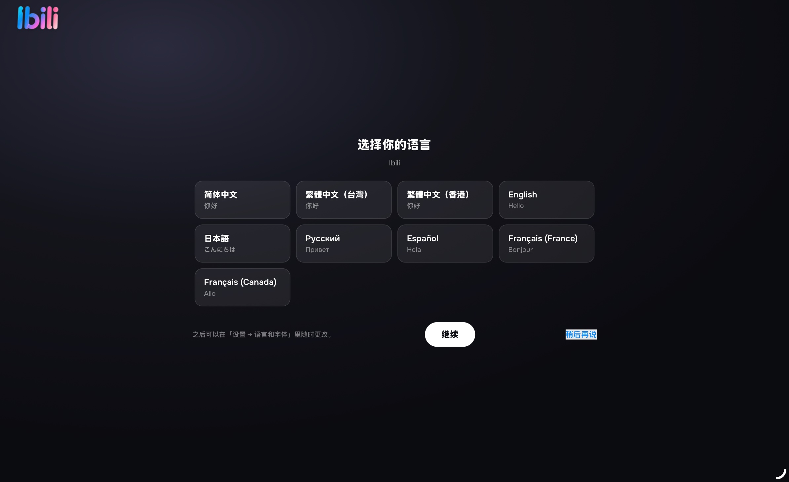 | 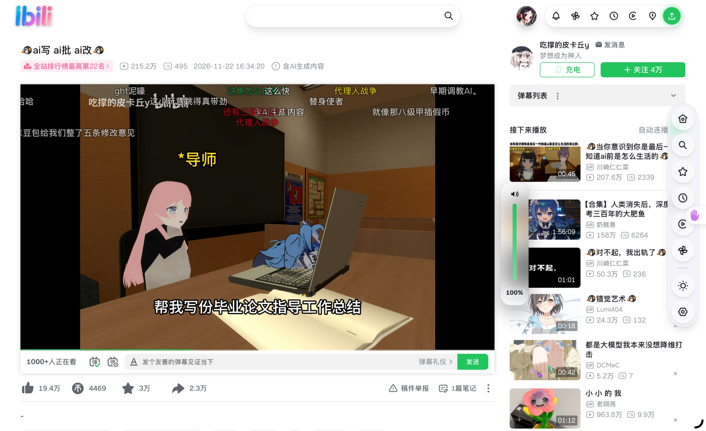 | 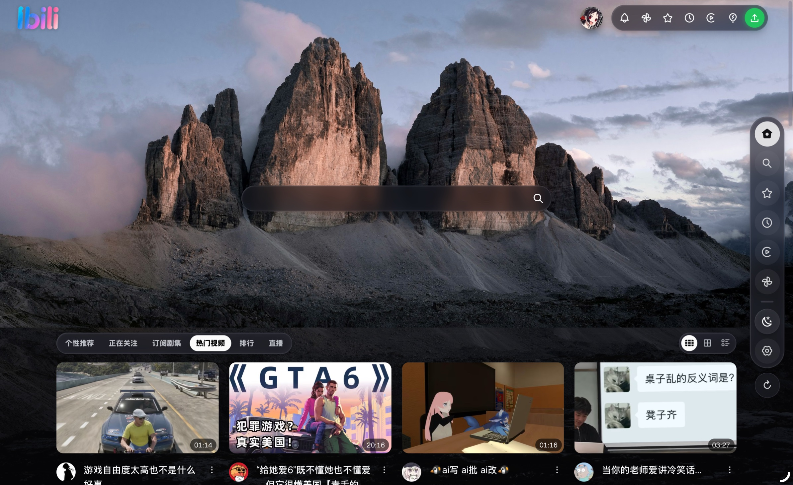 |

| Settings in the native menu | LOGO · 34 zones | Card context menu |
|---|---|---|
| 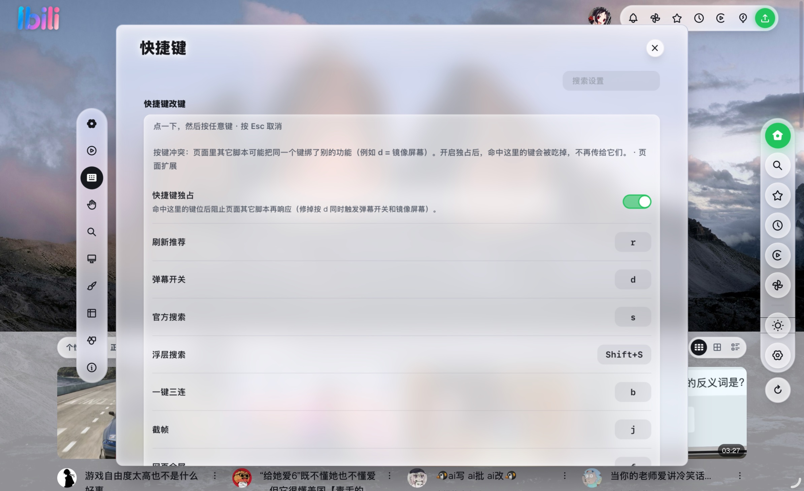 | 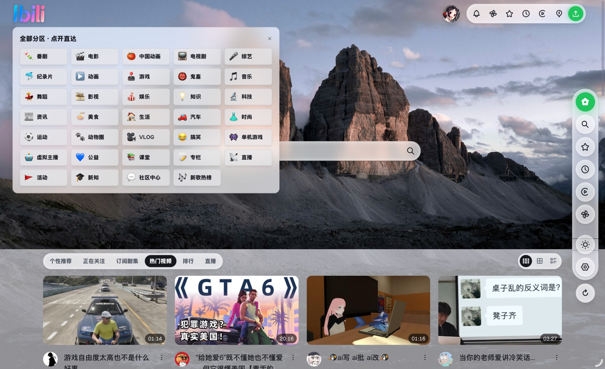 | 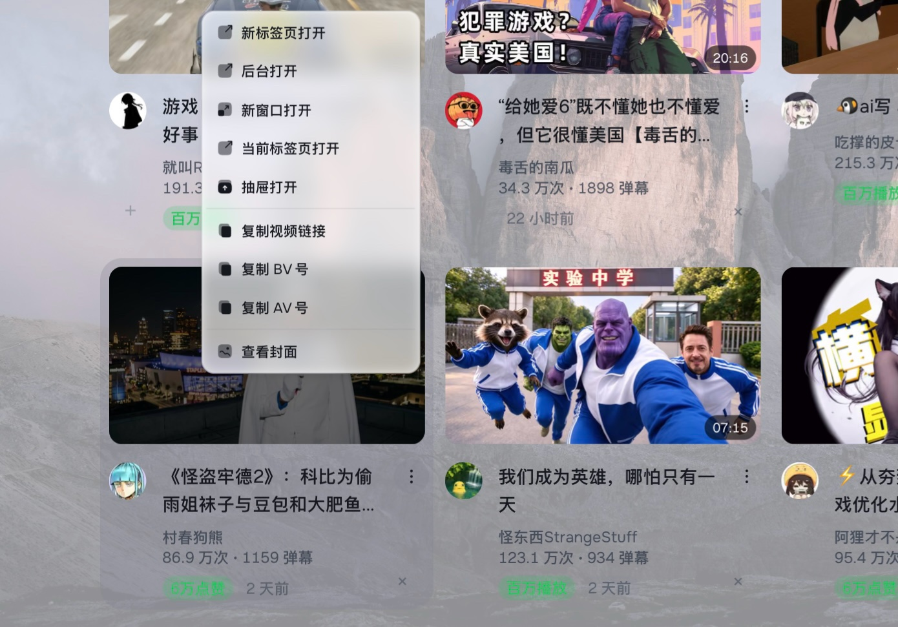 |

| Engineering menu | Zero-nav search | First-run support |
|---|---|---|
| 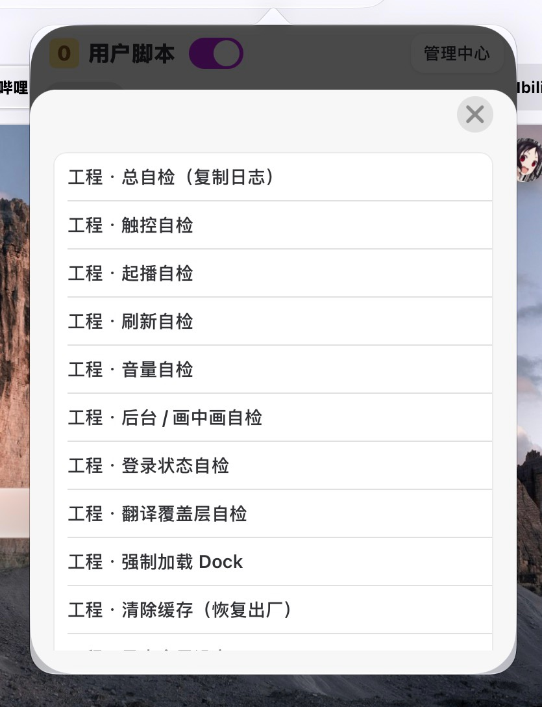 | 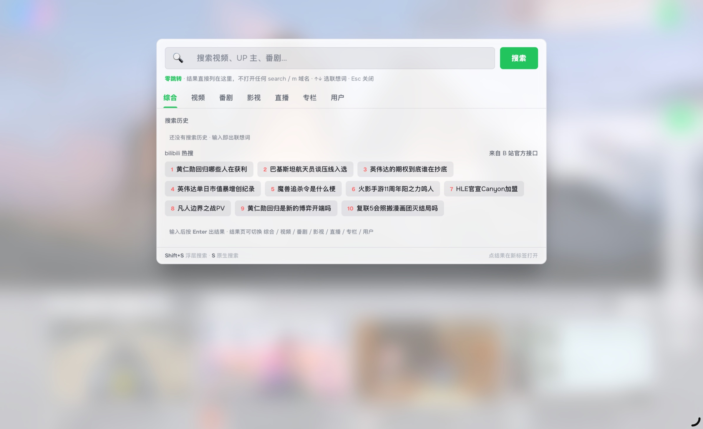 | 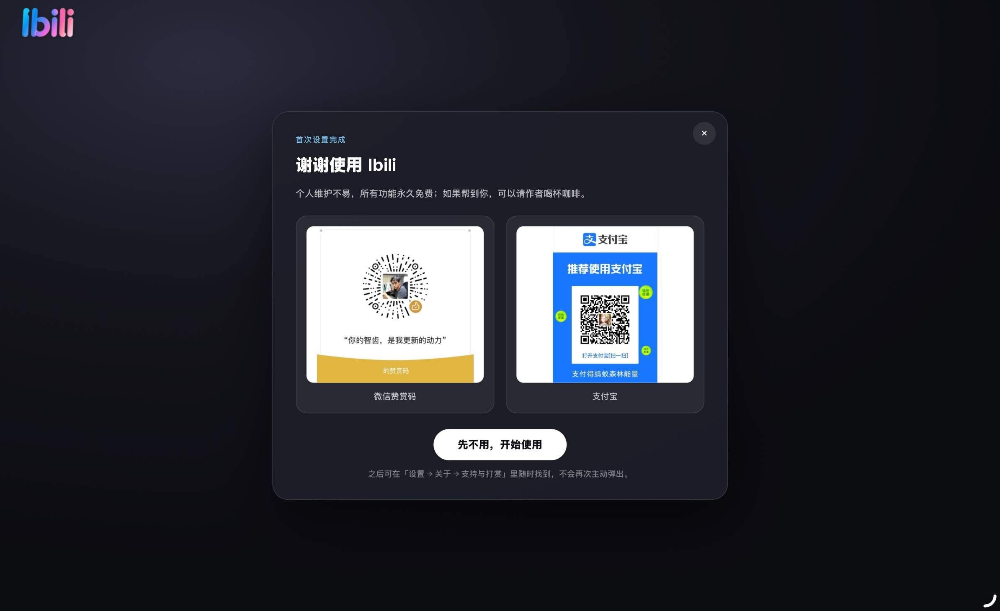 |

| × and ＋ · video removed | About · all settings | Full card grid |
|---|---|---|
| 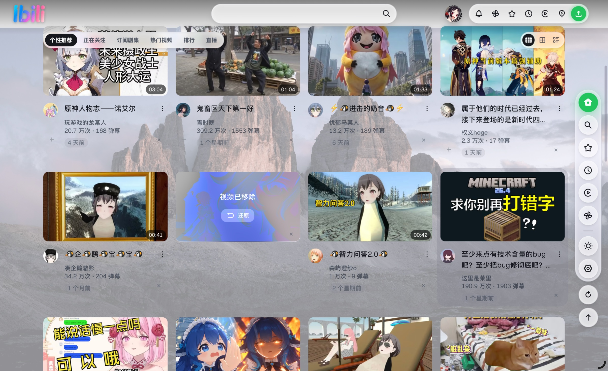 |  | 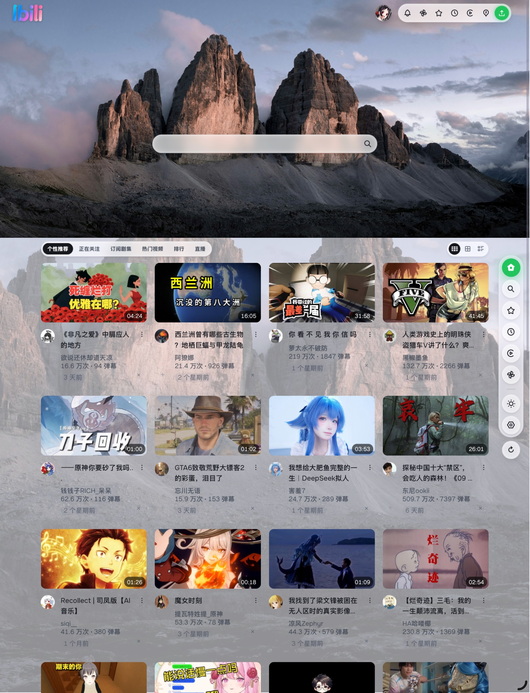 |

<details>
<summary>Shot index (number → content → section)</summary>

- `0` Light home hero: large search bar, Rocky Mountains wallpaper, right Dock, first card row — top Hero
- `1` First-run nine-language picker with Continue / Later — Nine UI languages
- `2` Playback page: full danmaku + green 100% HUD on the right — Touch
- `3` Dark home, same scroll position as `0` — Redesign / Dark mode
- `4` Settings → Shortcuts: exclusivity switch, `r / d / s / Shift+S / b / j` defaults, glass — One menu / Shortcut reference
- `5` The 34 official zones opened from the `ibili` mark — LOGO zone entry
- `6` Card context menu (new tab / copy link / view cover…) — Feed control
- `7` Stay's Engineering menu: eight self-checks + Force-mount Dock + Factory reset — Engineering menu
- `8` `Shift+S` overlay: seven tabs, official hot searches, zero navigation — Search
- `9` First-run support dialog after setup — First-run flow
- `10` Home cards: bottom-left ＋, bottom-right ×, and "Video removed / Undo" after tapping × — You control the feed
- `11` About: support codes, QQ group, Export / Import all settings, Diagnose & Reset — Engineering & data
- `12` Full home card grid with both buttons on every card — Redesign

</details>

> Numbering and naming: [`docs/截图规范.md`](docs/截图规范.md).

---

## Install

1. Install **Stay** from the App Store and enable it in Safari extensions;
2. Stay → Userscripts → `+` → import `Ibili.user.js` via URL / file / paste, then **make sure the script switch is on**;
3. Safari address bar → "Size / aA" → **Request Desktop Website**, keep `www.bilibili.com`;
4. Reload Bilibili. The first run asks you to pick a language.

Manual download (paste into Stay's URL import):

```
https://raw.githubusercontent.com/ElioXBlaze/Ibili/main/Ibili.user.js
```

Metadata declares `@run-at document-start`, `@inject-into content`, 11 `@match`, 7 `@connect` and 7 `GM_*` grants. Missing Stay APIs degrade gracefully instead of white-screening.

> **No auto-update**: the script declares neither `@updateURL` nor `@downloadURL`, so Stay will not check for new versions. Re-import or paste over it to upgrade; your settings and language choice are kept.

`m.bilibili.com` only gets partial functionality and desktop browsers are untested — this is built for the **iPad desktop web version**.

---

## Shortcut reference

14 factory defaults, all editable in Settings → Shortcuts, plus a "Shortcut exclusivity" switch (window capture + `stopImmediatePropagation`, so other scripts on the page cannot fire on the same key).

| Key | Action | Key | Action |
|---|---|---|---|
| `b` | One-tap triple | `d` | Danmaku toggle |
| `f` | Bilibili web fullscreen | `q` | Mini / PiP window |
| `r` | Refresh feed | `j` | Frame capture |
| `m` | Mute | `-` / `=` | Speed down / up |
| `s` | Search | `Shift+S` | Zero-nav search overlay |
| `Shift+F` | Picture fill toggle | `Shift+R` | Fill reset |
| `g` | Study Mode | | |

> Older docs list `c` for capture, `p` for PiP and `[` `]` for speed — those are **BiliPad-era defaults**. Since 3.0.13 the factory baseline uses `j` / `q` / `-` / `=`. Upgrading never overwrites keys you customized.

With Search Page Mode on, `s` **scrolls to top and focuses the large search bar** instead of forcing the hidden native header into view. On ordinary pages it hands off to Bilibili's native search completely — Enter is not intercepted and no overlay pops up.

---

## Full feature list

**Playback** — autoplay (sound first → muted on refusal → unmute on first gesture), remembered volume, 41 speed steps, remembered rate, temporary 2× on long-press and cancel, pitch preservation, background playback and PiP (enabled when supported, honestly reported when not), media metadata / Control Center, clean direct stream link (read-only, only streams the current page is allowed to play), `j` frame capture (canvas taint probe + system share first).

**Touch** — hold-to-lock / slide-up stepping / slide-down unlock, left brightness and right volume, glass HUD, horizontal swipe yielding to native seek, rate lock, 160ms coalescing, 340ms hold threshold, 280ms / 10s / 44px touch parameters, all adjustable; the bottom-right 140px is reserved for iPadOS window-resize corner gestures.

**Search** — `s` native / large search bar, `Shift+S` overlay (suggestions, hot searches, categories, zero navigation), a search guard that does not hijack official submissions; the overlay fully inherits bew variables.

**Feed control** — one-tap triple, Study Mode zone filtering, 15 zones and uploader-mid blocklist, verified refresh, bottom-right × official dislike + silent report, bottom-left ＋ local list, 34 official zones, LOGO double-tap home.

**Interface** — full redesign, wallpaper and mask (Rocky Mountains by default, 60% mask, focus blur), light / dark / follow system, theme color `#22c55e`, right Dock, legacy top bar, Search Page Mode (large logo + large search bar + 22-娘), adjustable glass and opacity, secondary menu hover-expand and 1-second tap-expand on touch, nine UI languages, first-run flow and support dialog.

**Engineering & data** — eight self-checks (all / touch / autoplay / refresh / volume / background PiP / login state / translation overlay), unified auto-copied log, Force-mount Dock, Factory reset, Export / Import all settings (84 player config fields + 41 steps + shortcuts + redesign preferences + GM + localStorage + 6 language cookies + session flags as one JSON, auto-copied and downloaded).

**On-device self-checks** (Safari / Stay console, all read-only)

```js
__BP_UI_API__.deviceCheck()        // version, language, buttons, request bridge, Dock, wallpaper
__BP_I18N_AUDIT__()               // walks the whole page, lists uncovered visible text
__BP_UI_API__.xhrBridge()         // which channel requests actually took
__BP_UI_API__.logoZone()          // zone entry state and hidden legacy logos
__BP_UI_API__.wallpaperViewport() // wallpaper pinning state
```

---

## How it is built

The repository ships **one finished `Ibili.user.js`**. It embeds the BewlyBewly redesign layer and Vue runtime, the BiliPad v2.5.1 player layer, and a merge layer that puts both complete scripts on **one settings store, one menu, one lifecycle** — not two parallel sets of listeners.

> There is **no `src/` and no build script** in the repo. The "sources" mentioned in the file header describe logical lineage, not a reproducible build chain. Edit the shipped file directly and run the regression suite. The previous README implied a build pipeline; corrected here.

The hard parts were all iPad Safari specifics:

- **Shadow DOM** — the redesign layer mounts its Vue app inside `#bewly`'s ShadowRoot, which plain `document.querySelector` cannot reach. Injection, styles and click targeting walk shadowRoots individually; events use `composedPath()` to beat retargeting.
- **Request bridge** — Stay's `GM_xmlhttpRequest` loses login cookies cross-site to `api.bilibili.com`, so Watch Later reported "not logged in" while triple and follow worked. Writes now go through page `fetch`, `bili_jct` is filled in, the original domain is preferred, and failures are reported honestly.
- **Three language layers** — Ibili's 270-key dictionary / the redesign layer's own locale bundle / Bilibili's own UI and UGC. The first two are covered and kept in sync; the third is untouched.
- **Wallpaper viewport** — Safari's layout and visual viewports differ while toolbars animate. The wallpaper layer is pinned with `100dvh`, `transform:none` and `background-position:center bottom`, rescanned via `visualViewport`.
- **Route healing** — `?page=` routes plus Safari bfcache could blank the page (or drop the whole script) on Back; `popstate` / `pageshow` now heal it, with a single reload only when the redesign layer is genuinely gone.
- **Factory baseline** — one JSON is the single source of truth for first load, factory reset and "restore defaults". On upgrade, seeding steps aside so custom keys, theme and language are never overwritten.

**Verification**: every release runs a **Chromium simulation** regression (currently 224 checks + 12 base checks + 38 zero-error self-check entries). iPad Safari + Stay is iterated continuously with screenshots from the user; **no claim of full developer-side on-device coverage**.

---

## Known limits

- **System volume is off-limits to web pages** on iOS / iPadOS — hardware keys and Control Center own it. The left-half bar adjusts visual brightness and the page volume layer.
- **True edge-to-edge is impossible** — Safari's address bar, tab bar and home indicator are system chrome. A portrait video cannot be both complete and edge-to-edge.
- **Built for the iPad desktop web version** — `m.bilibili.com` gets partial functionality, desktop browsers are untested.
- **Automatic PiP** — Apple requires `AVPlayerViewController` for gesture-less PiP; the web layer has no such switch. Unsupported cases are reported honestly, never faked.
- **Language boundary** — Bilibili's own UI language and video titles / uploader names / comments are not decided by the script; it writes preferences only and never rewrites URL language segments.
- **Do not run two redesign scripts** — the official BewlyBewly or another home-redesign script will fight over the same DOM. Keep one.
- **The "Open in the Bilibili App" banner at the top of every shot** is Safari's Smart App Banner, drawn by the system from the page meta. The script cannot hide it.

### FAQ

**Nothing happens after install?** Check Request Desktop Website, `www.bilibili.com`, and the Stay script switch; then run `__BP_UI_API__.deviceCheck()` and look at `fetchPatched` and `shadowRoots`.

**Dock vanished?** Engineering menu → Force-mount Dock. If it is still gone, check whether the URL carries a language segment like `/ja/` (old versions did that; current ones do not).

**Back to a fresh install?** Engineering menu → Clear cache / Factory reset wipes GM / localStorage / sessionStorage / 6 language cookies / URL language segments and replays the first-run flow. **It erases custom settings** — export all settings first.

**Will upgrading re-show the language / support dialogs?** No. `langDone` / `donateDone` persist; only clearing script data or a factory reset replays them.

---

## Changelog

Full history: [Releases](https://github.com/ElioXBlaze/Ibili/releases). 3.0.0–3.0.16 covered the merge, settings integration, nine languages, touch and on-device structural fixes. Recent highlights:

- **3.1.0** — viewport convergence: removed the leftover `100lvh` inflation rule, moved the whole page to one `--ibili-vh` source of truth, unified the fallback background, forced a paint on viewport change, and cut five listeners plus five timed rescans down to `visualViewport` + `pageshow` + one observer. Root-fixes the recurring bottom white/black strip, ghost text and spinner residue. Adds `viewportState()` for on-device checks.
- **3.0.26** — the theme-colored round TV logo is hidden too; only the `ibili` mark remains.
- **3.0.25** — LOGO loses its capsule shell and uses the transparent mark directly; the Search Page Mode SVG is hidden; the zone panel inherits bew glass variables.
- **3.0.24** — LOGO zone entry returns: tap for 34 official zones, double-tap home, same mark on both top bars.
- **3.0.23** — wallpaper pinned; no drift or bottom strip when Safari toggles toolbars.
- **3.0.22** — bottom-right × becomes a real one-tap "Not interested"; `s` scrolls to top and focuses the large search bar; uploader names read from redesign cards; Watch Later fixed.
- **3.0.21** — cross-scope `shadowCss()` error fixed; legacy panel dead code removed; `deviceCheck()` added.
- **3.0.20** — five legacy panel render functions deleted; settings fully merged; ~256KB slimmer.
- **3.0.19** — bottom-right × decoupled from Study Mode / show-＋ switches; tooltip follows all nine languages.
- **3.0.17** — card buttons re-logicked: × for official dislike, ＋ for the local list; login state fixed; URL language-segment navigation retired (404 + lost Dock).
- **3.0.13** — factory baseline lands: one state for first load / factory reset / restore defaults, keys changed to `j` / `q` / `-` / `=`.

---

## Feedback

QQ group **1134860332**. Invite links may expire; searching the number always works. A screenshot plus `__BP_UI_API__.deviceCheck()` output makes bug reports much faster.

---

## Credits

- [BewlyBewly](https://github.com/BewlyBewly/BewlyBewly) — redesign and interaction patterns, MIT, archived (last release v0.41.1); the community successor is BewlyCat. Ibili continues this branch.
- [Bilibili-Evolved](https://github.com/the1812/Bilibili-Evolved) — componentization inspiration only; no code from it is included and no license claim is made about it.
- Everyone who left B-station script notes on Greasy Fork.

---

## Disclaimer

A personal, self-use browsing-experience script, unrelated to Bilibili officially. It does not bypass paid content, does not crack anything, and collects or uploads no usage data; network requests only load page resources and call Bilibili's own endpoints. Use at your own risk and follow the platform terms.

## License

[MIT](LICENSE). Portions derived from MIT projects retain their original copyright notices; see Credits.
