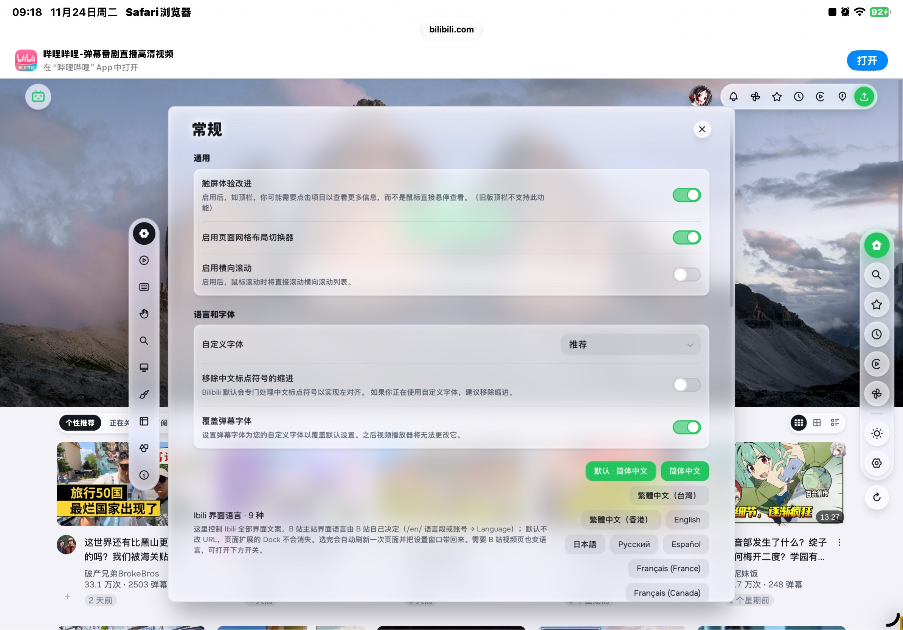
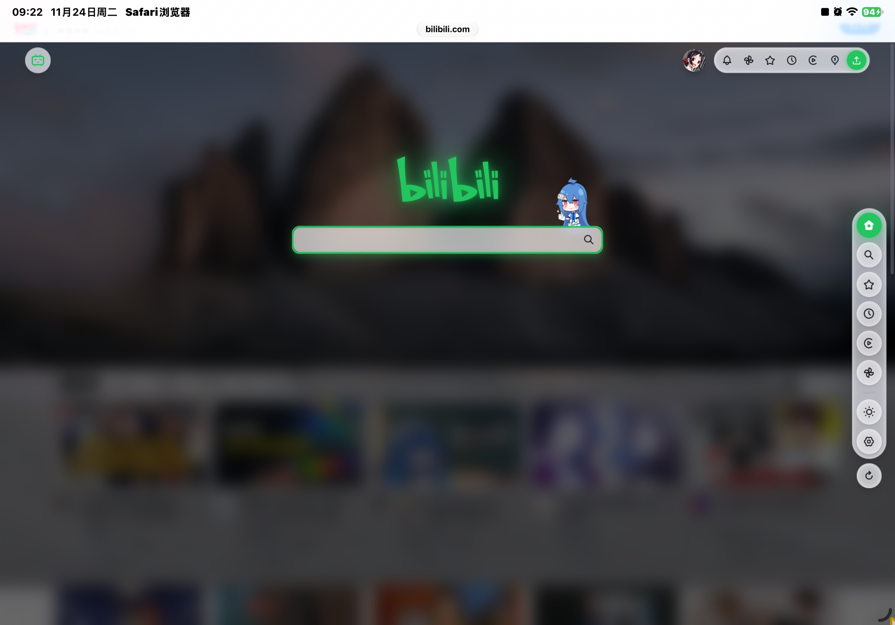

# Ibili

> 当前版本：**3.0.26**　作者：Xi/ElioXBlaze　许可：MIT

**iPad / iPadOS Safari 上的哔哩哔哩，重新设计一遍。**

Ibili 是 BilibiliPlus 的接棒项目——原项目已暂停服务，全部能力迁移到这里，并在原有基础上补了三件一直缺的东西：**整站页面美化**、**九种界面语言**、**深色模式**。

一句话概括：网页版 B 站的功能全、键盘能打，移动端 App 的手势顺滑、界面好看。Ibili 把这两头接在一起——**既保留网页端的全部能力，又给它换上一套现代界面和 App 级的触控手势**。

| 首次启动选语言 | 美化后的首页 |
|---|---|
|  |  |
| **设置 · 语言和字体** | **深色界面** |
|  |  |

---

## 从 BilibiliPlus 迁过来

| | BilibiliPlus | Ibili |
|---|---|---|
| 自动起播 / 倍速 / 触控手势 / 截帧 / 三连 / 屏蔽 | ✅ | ✅ 原样保留 |
| 整站页面美化 | — | ✅ 新增 |
| 九种界面语言 + 首次启动语言选择 | — | ✅ 新增 |
| 深色模式 | — | ✅ 新增 |
| 设置入口 | 独立悬浮面板 | 按功能并入站点原生菜单 |

原有键位、手势、开关语义都保留，不需要重新学一遍。

## 新增的三件事

### 整站页面美化

首页、搜索页、分区、动态、空间、稍后再看、收藏夹一起换新：顶部栏与 Dock 重排、卡片栅格重做、页面最大宽度可调、圆角与字距统一、壁纸与毛玻璃层、启动动画与骨架屏。四个自定义分类页也不再是纯色底。

- **LOGO 分区入口**：顶栏只留一枚 `ibili` 渐变小图标（原生 LOGO、bew 搜索页的大 SVG 一并隐藏），点一下展开分区面板，双击回首页。
- **设置跟随主题**：Ibili 的设置面板不写死白底，圆角 / 边框 / 底色 / 模糊 / 阴影 / 文本色全部继承美化层的设计变量——你在美化设置里切「毛玻璃」还是「扁平」，这里同步变。
- **壁纸贴底**：Safari 显隐工具栏时全屏壁纸层不再上移、底部不漏浅色边。

### 九种界面语言

首次启动先选语言，之后随时可以在「设置 → 语言和字体」里改：

**简体中文 · 繁體中文（台灣）· 繁體中文（香港）· English · 日本語 · Русский · Español · Français (France) · Français (Canada)**

- 这一层只管 Ibili 自己的界面文案；B 站主站语言仍由 B 站决定（`/en/` 语言段或账号 → Language），脚本**默认不改 URL**，扩展 Dock 不会消失。
- 如果想让 B 站视频页也跟着变语言，设置里有单独开关。
- 选完会自动刷新一次页面并把你送回设置窗口。

### 深色模式

跟随系统，也可手动锁定。美化层、设置面板、诊断浮层、弹幕区一起变暗，不是简单反色。

## 原有能力（全部保留）

- **播放器**：自动起播（带声音优先 → 被拒才静音 → 首次手势同步解除静音，音量记忆）、41 档扩展倍速、`F` 转发 B 站自己的全屏按钮并智能铺满（横屏裁切去黑边、竖屏完整不裁人脸）
- **触控手势**（网页层实现，不交给系统播放器）：长按临时 2×、按住锁定、长按中上滑逐档、长按中下滑解锁、左半屏画面亮度 / 右半屏音量、横向滑动让行给原生快进；配极简竖条 HUD
- **搜索**：`S` 唤出 B 站原生搜索（可复原）、`Shift+S` 独立浮层搜索（联想词 + 七栏分类），零导航、不发任何跳转
- **内容治理**：`B` 一键三连（缺币自动补赞藏）、`G` 学习模式一键屏蔽分区、UP 主按 mid 屏蔽、`R` 刷新推荐且**核对卡片真的变了**才报成功
- **卡片右下 ×**：一键「不感兴趣」——自动走完美化层的三点菜单，再向 B 站官方接口申报 dislike，卡片当场变成「视频已移除」；左下 ＋ 则是写进自己的屏蔽名单（受学习模式开关控制），两枚各管各的
- **工程菜单**：自检入口点一下生成统一诊断日志并自动复制、强制重挂 Dock、清除缓存恢复出厂
- **素材**：`C` 截帧（canvas 污染探针 + 系统分享优先）、无水印直链（只读当前页面有权播放的原始流）
- **画中画**：支持就开，不支持如实说明，不谎报成功

## 安装

1. App Store 安装 **Stay**，在 Safari 扩展里启用；
2. Stay → 脚本 → 新建 → 粘贴 `Ibili.user.js` 全文 → 保存并开启；
3. Safari 地址栏左侧「大小 / aA」→「请求桌面网站」，域名保持 `www.bilibili.com`；
4. 刷新 B 站，第一次会先让你选语言。

也可以直接打开安装直链：

```
https://raw.githubusercontent.com/ElioXBlaze/Ibili/main/Ibili.user.js
```

元数据里 `@run-at document-start`、`@inject-into content` 与 `GM_*` 权限都已写好；Stay 缺哪个 API 会自动降级，不会白屏。

## 关于这个单文件

仓库里的 `Ibili.user.js` 是构建产物，不要手改。它由四个来源合成：

- `src/bewly.js` — 页面美化与 Vue 运行时（源自 [BewlyBewly](https://github.com/BewlyBewly/BewlyBewly)，MIT）
- `src/bilipad.js` — 播放器 / 触控 / 搜索 / 三连 / 屏蔽（即原 BiliPad v2.5.1，也就是 BilibiliPlus）
- `src/app.js` — 融合层：九语言 i18n、设置页、语言页、与站点原生的联动
- `src/locales/` — 九种语言文案

融合层做的事只有一件：让两套各自完整的脚本**共用一份设置、一套菜单、一个生命周期**，而不是并排跑两套监听器。

## 更新日志

- **3.0.26** — 顶栏那枚主题色圆底小电视（`.logo.activated`）也纳入隐藏，全页只留 ibili 字标。
- **3.0.25** — 统一视觉：LOGO 去掉圆形胶囊壳，直接是透明 ibili 字标；搜索页模式的大 bilibili SVG 一并隐藏（不再「两个 LOGO」）；分区面板不再写死白底，毛玻璃 / 扁平设置直接继承。
- **3.0.24** — LOGO 分区入口回归：ibili 渐变小图标，点开是分区面板，双击回首页；两套顶栏（美化版与原生版）都挂同一枚。
- **3.0.23** — 修壁纸「出溜」：Safari 显隐工具栏时全屏壁纸层按旧视口缓存合成层、导致画面上移底部漏底；现在钉 `top/left:0` + transform 归零 + `100dvh`，并跟随 `visualViewport` 重扫。
- **3.0.22** — 右下 × 变成真·一键「不感兴趣」：合成 contextmenu 唤出美化层三点菜单 → 自动点「不感兴趣」→ 弹窗里派发 Enter 确认 → 走官方 dislikeVideo 申报；搜索页模式下 `S` 改为「回顶 + 聚焦美化层大搜索栏」，不再把被隐藏的原生顶栏顶出来；UP 名改从美化层卡片 `.channel-name` 读取，绝不再把「未知 UP」写进名单；稍后再看「点不动」修复（写操作回到 `www` 主站同域路径）。
- **3.0.21** — 修 `shadowCss()` 自查入口在真机报 `injectPageCssToShadows is not defined`（跨 IIFE 引用改走 window 桥）；清掉旧面板遗留的半死代码；新增 `deviceCheck()` 一条命令汇总全部真机验收项。
- **3.0.20** — 旧面板五个页签的渲染函数整体删除，`render()` 改为纯转发融合层——设置彻底并入站点原生设置窗口里的 Ibili 分类。
- **3.0.19** — 右下 × 与「学习模式」「显示 ＋ 按钮」两个开关解耦（关掉学习模式也能用）；× 的 tooltip 跟随九语言；「不感兴趣」选择器只认语义元素，不再误伤 notice / toast 的关闭按钮。
- **3.0.18** — 关总开关时把注入的 × 一并撤掉；清理 `bpe-hide-up` 等无写入方的残留规则。
- **3.0.17** — 首次发布（继承 BiliPad v2.5.1 全部能力 + 页面美化 / 九语言 / 深色模式）。

## 已知边界

- **系统音量网页无权**：iOS / iPadOS 上音量始终由物理键与控制中心控制，网页拿不到。左半屏那根竖条调的是画面视觉亮度与网页音量层。
- **真铺满的极限**：Safari 地址栏、标签栏、底部手势条是系统外壳，脚本隐藏不了。竖屏视频做不到「既完整又铺满」，二选一。
- **只为 iPad 网页版写**：`m.bilibili.com` 只能用部分功能，桌面浏览器未做验证。
- **自动画中画**：没有用户手势就想自动切 PiP，Apple 要求 video 走 `AVPlayerViewController`，网页层没有对应开关——做不到的部分脚本会如实说明。
- **美化层与第三方美化脚本冲突**：同时开 BewlyBewly 官方版或其他首页美化脚本会互相抢 DOM，请只留一个。

## 反馈

QQ 群：**1134860332**（插件反馈）。群链接可能过期，搜群号长期有效。

## 致谢

- [BewlyBewly](https://github.com/BewlyBewly/BewlyBewly) — 页面美化与交互范式，MIT
- [Bilibili-Evolved](https://github.com/the1812/Bilibili-Evolved) — 组件化思路与截图探针
- 以及所有在 Greasy Fork 上留下踩坑记录的 B 站脚本作者

## 免责声明

个人自用的浏览体验优化脚本，与哔哩哔哩官方无关。不绕过付费内容、不破解、不上报任何数据，网络请求只发往 B 站自己的接口。使用风险自负，请遵守平台条款。

## 许可

MIT License，见 [LICENSE](LICENSE)。