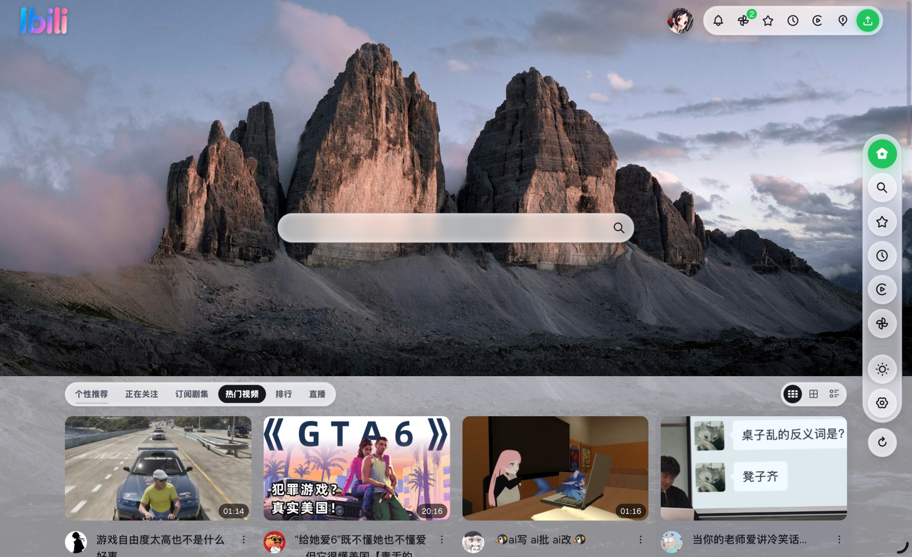
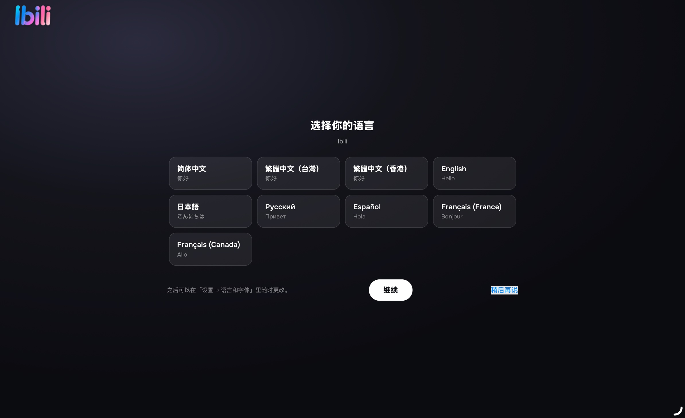
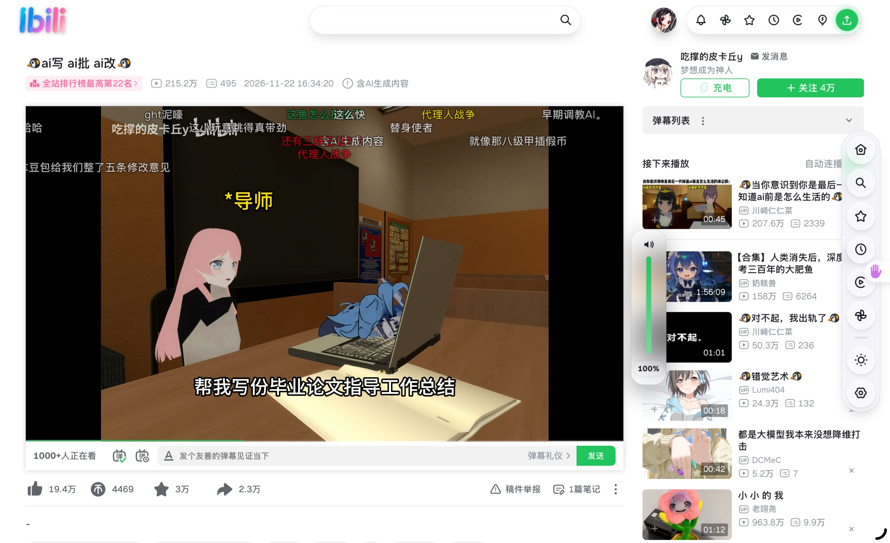
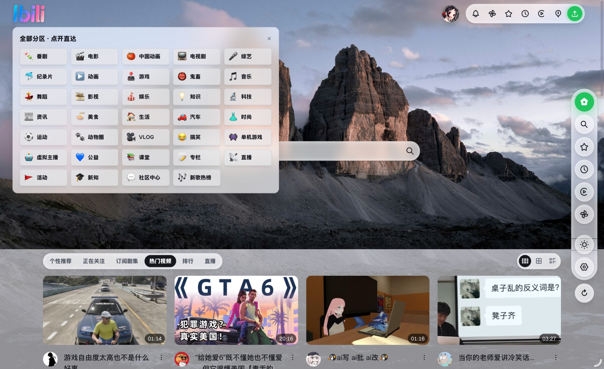
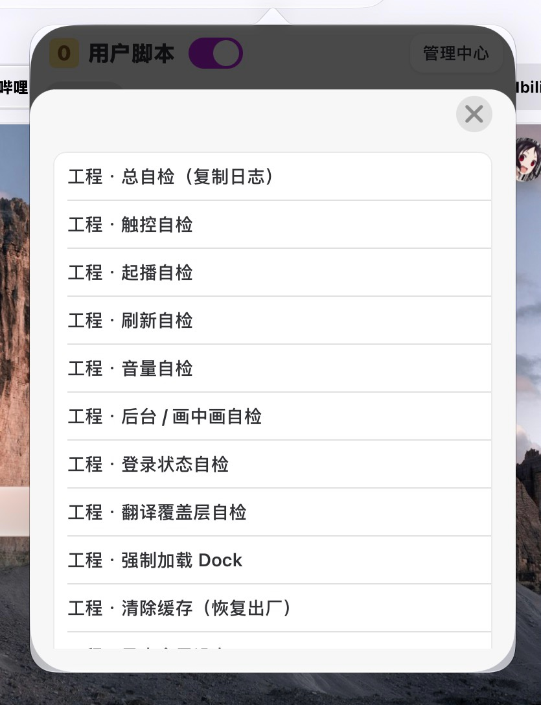
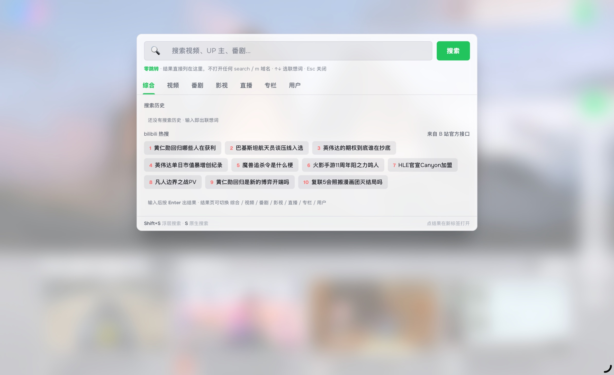
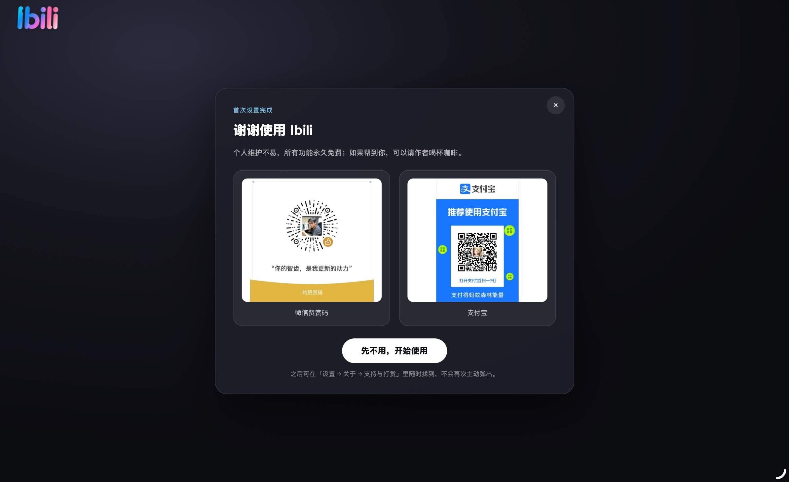
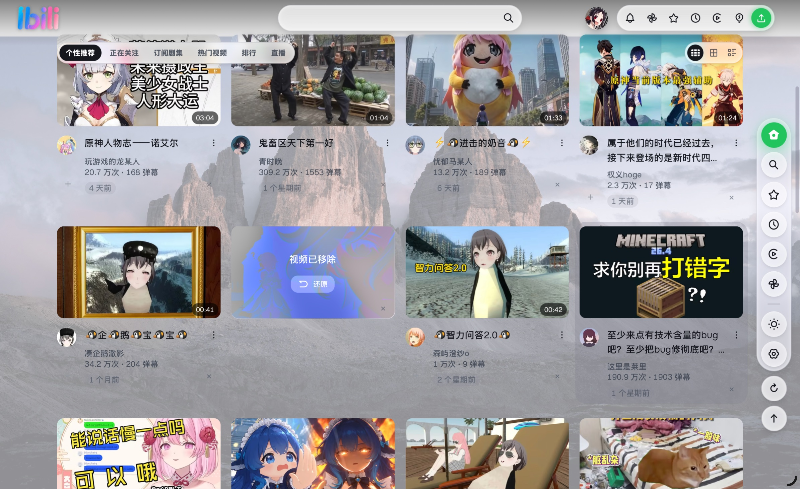
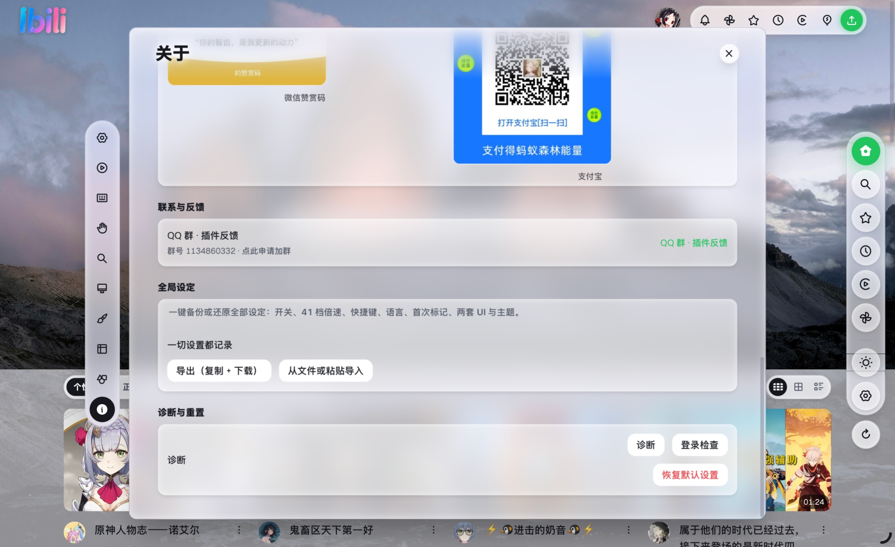
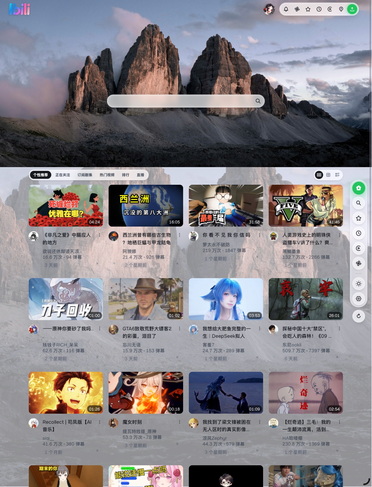

<div align="center">

# Ibili

**把 iPad 上的哔哩哔哩，重新做一遍。**

[](https://github.com/ElioXBlaze/Ibili/releases)
[](LICENSE)
[](#安装)
[](#九种界面语言)
[](#安装)

**[English →](README.en.md)**　·　中文　·　作者 **Xi/ElioXBlaze**　·　QQ 群 **1134860332**



</div>

网页版 B 站功能全、键盘能打；移动端 App 手势顺滑、界面好看。
**Ibili 把这两头接在一起**——不砍网页端的任何能力，再给它换上一套现代界面和 App 级的触控手势。

它是 **BilibiliPlus**（播放器层内部代号 BiliPad v2.5.1，原项目已暂停）的接棒项目，融合了已归档的 [BewlyBewly](https://github.com/BewlyBewly/BewlyBewly) 美化层，从 3.0.0 一路迭代到 **3.1.0**。一个文件、一次安装，装完第一次打开会先让你选语言。

---

## 30 秒决定要不要留

| | | |
|---|---|---|
| **41 档**倍速，0.0312× 到 32× | **9 种**界面语言 | **14 个**快捷键 |
| **不进系统全屏**，弹幕一个不少 | **1 个文件**，无构建、无依赖 | **0** 数据上报 |

不喜欢的视频一键消失，想看的视频永远顺手；设置不是另开一个悬浮窗，而是**直接长在站点自己的菜单里**。

---

## 先看这几个，最上头

### ① 播放：全键盘、全倍速，但绝不丢弹幕

自动起播会先试着带声音，被浏览器拒了才静音，等你第一次碰屏幕再悄悄把声音还回来，音量记忆保留。**41 档扩展倍速**（键盘走完整 41 档，触控长按封顶 6×），长按、锁定、逐档、记忆全都在。

`F` 只转发 **B 站自己的「网页全屏」按钮**——系统全屏 / AVKit 一律拦下改道，因为进了那一层，弹幕、控制栏、长按手势会全丢。`Shift+F` 调的是画面填充策略：横屏裁切去黑边、竖屏完整不裁人脸。

### ② 触控：像 App，不像网页

手势全部在网页层实现，不把视频交给系统播放器：长按临时 2×、按住锁定、长按中上滑逐档 / 下滑解锁、左半屏调画面亮度、右半屏调网页音量，横向滑动让行给 B 站原生快进。0–100% 的玻璃胶囊竖条 HUD 跟着 bew 的主题、毛玻璃、透明度一起变，不是一根白线。

### ③ 首页你说了算

卡片右下 **×** = 一键「不感兴趣」：自动走完美化层的三点菜单、向 B 站官方申报 dislike，卡片当场变成「视频已移除」。
左下 **＋** = 写进自己的屏蔽名单，按 UP 名识别（不会存「未知 UP」），**开启学习模式后才真正屏蔽**。两枚按钮同源、各管各的。

再叠加 `b` 一键三连（缺币自动补赞藏）、`g` 学习模式屏蔽分区、`r` 刷新推荐且**核对卡片真的变了**才报成功。

### ④ 整站换皮，而且设置也会跟着换

首页、搜索页、分区、动态、空间、稍后再看、收藏夹一起重排：顶栏与 Dock、卡片栅格、圆角字距、壁纸与毛玻璃、启动动画。顶栏只留一枚透明 `ibili` 渐变小图标，**点一下展开 34 个官方分区，双击回首页**。

关键在一致性：Ibili 的设置面板不写死白底，圆角 / 边框 / 底色 / 模糊 / 阴影 / 文本色全部继承美化层的 `--bew-*` 变量。你在美化设置里切毛玻璃还是扁平、调透明度、换主题色，设置页、分区面板、截帧弹窗、搜索浮层**同步变**。Safari 显隐工具栏时壁纸也不会「出溜」、底部不漏白边黑边。

### ⑤ 九种语言，第一次打开就问你

简体中文 · 繁體中文（台灣）· 繁體中文（香港）· English · 日本語 · Русский · Español · Français (France) · Français (Canada)

首次启动：你好轮播 → 选语言 → 一次性打赏弹窗 → 关闭后**再也不主动弹**。设置里随时改，选完自动刷新一次并把你送回设置窗口。字典 270 键 × 9 语，另有全页 UI 文本覆盖层与 `__BP_I18N_AUDIT__()` 查漏入口。

> 这层只管 Ibili 与美化层的界面文案。B 站主站语言、视频标题 / UP 名 / 评论属于内容与 B 站自己的设置，脚本不翻译、不篡改；默认**不改 URL 语言段**（历史上跳 `/ja/` 会 404 且 Dock 消失，已彻底停用），只写语言偏好 cookie 与 `<html lang>`。

### ⑥ 一个菜单管全部

旧版那个悬浮设置窗已经彻底删掉。设置按功能**并入站点原生设置窗口**：二级菜单岛新增「视频播放 / 快捷键 / 触控手势 / 搜索与工具」四项，能合并的并进「常规 / 页面 / 兼容性 / 关于」。关于页换成 Ibili 品牌、版本作者、能力探测、打赏码与 QQ 群。

还有一排 **工程菜单**（Stay 的脚本菜单命令）：8 个自检入口点一下就生成统一诊断日志并**自动复制**（设备、版本、9 条通路、Dock 状态、首次标记、配置摘要），外加强制挂载 Dock、清除缓存恢复出厂、导出 / 导入全局设定。

---

## 看一眼

**13 张全部来自 iPad Safari + Stay 真机**，按 `0`–`12` 编号放在 `docs/`。

| 九种界面语言 | 播放页触控 HUD | 深色模式 |
|---|---|---|
|  |  |  |

| 设置并入原生菜单 | LOGO · 34 分区 | 卡片上下文菜单 |
|---|---|---|
|  |  |  |

| 工程菜单 | 零导航浮层搜索 | 首次打赏 |
|---|---|---|
|  |  |  |

| × 与 ＋ · 视频已移除 | 关于页 · 全局设定 | 卡片栅格全景 |
|---|---|---|
|  |  |  |

<details>
<summary>逐张索引（编号 → 画面 → 对应章节）</summary>

- `0` 亮色首页主视觉：大搜索栏、落基山壁纸、右侧 Dock、首排卡片 —— 顶部 Hero
- `1` 首次启动的九语选择，含「继续 / 稍后再说」—— 九种界面语言
- `2` 播放页：满屏弹幕 + 右侧 100% 绿色竖条 HUD —— 触控
- `3` 深色首页，与 `0` 同位置对比 —— 整站换皮 / 深色模式
- `4` 设置 → 快捷键：独占开关、`r / d / s / Shift+S / b / j` 新默认、毛玻璃底 —— 一个菜单管全部 / 键位速查
- `5` 点 `ibili` 字标弹出的 34 个官方分区 —— LOGO 分区入口
- `6` 卡片上下文菜单（新标签页 / 复制链接 / 查看封面…）—— 内容治理
- `7` Stay 里的工程菜单：8 个自检 + 强制加载 Dock + 恢复出厂 —— 工程菜单
- `8` `Shift+S` 浮层：七栏分类、B 站官方热搜、零跳转 —— 搜索
- `9` 首次设置完成后的打赏弹窗 —— 首次启动流程
- `10` 首页卡片：左下 ＋、右下 ×，以及点 × 后的「视频已移除 / 还原」—— 首页你说了算
- `11` 关于页：打赏码、QQ 群、全局设定导出 / 导入、诊断与重置 —— 工程与数据
- `12` 首页卡片栅格全景，两枚按钮在每张卡片上 —— 整站换皮

</details>

> 编号与命名对照见 [`docs/截图规范.md`](docs/截图规范.md)。

---

## 安装

1. App Store 安装 **Stay**，在 Safari 扩展里启用；
2. Stay → 用户脚本 → 右上角 `+` → 用「链接 / 文件 / 新建粘贴」导入 `Ibili.user.js`，**确认脚本开关已开启**；
3. Safari 地址栏左侧「大小 / aA」→「请求桌面网站」，域名保持 `www.bilibili.com`；
4. 刷新 B 站，第一次会先让你选语言。

手动下载地址（可直接粘进 Stay 的 URL 导入）：

```
https://raw.githubusercontent.com/ElioXBlaze/Ibili/main/Ibili.user.js
```

元数据已写好 `@run-at document-start`、`@inject-into content`、11 个 `@match`、7 个 `@connect` 与 7 个 `GM_*` 权限；Stay 缺哪个 API 会自动降级，不会白屏。

> **不会自动更新**：脚本没有声明 `@updateURL` / `@downloadURL`，Stay 不会帮你检查新版本。升级请重新导入或覆盖粘贴一次，配置和语言选择不用清。

移动端 `m.bilibili.com` 只能用到部分功能，桌面浏览器未做验证——这套东西是为 **iPad 桌面网页版**写的。

---

## 键位速查

出厂默认 14 项，全部可在「设置 → 快捷键」里改，并有「快捷键独占」开关（window 捕获层 + `stopImmediatePropagation`，避免和页面里其它脚本抢同一个键）。

| 键 | 作用 | 键 | 作用 |
|---|---|---|---|
| `b` | 一键三连 | `d` | 弹幕开关 |
| `f` | B 站网页全屏 | `q` | 建立小窗 |
| `r` | 刷新推荐 | `j` | 截帧 |
| `m` | 静音 | `-` / `=` | 倍速降 / 升一档 |
| `s` | 搜索 | `Shift+S` | 零导航浮层搜索 |
| `Shift+F` | 画面填充切换 | `Shift+R` | 填充复位 |
| `g` | 学习模式 | | |

> 旧文档里的 `c` 截帧、`p` 小窗、`[` `]` 升降档是 **BiliPad 时期的默认值**，3.0.13 起已按出厂基线换成 `j` / `q` / `-` / `=`。老用户自定义过的键位不会被升级覆盖。

`s` 在首页搜索页模式下会**回到顶部并聚焦美化层的大搜索栏**，不再把被隐藏的原生顶栏顶出来；普通页面则完整交还 B 站原生搜索框，回车不拦、不弹浮层。

---

## 功能全量

**播放**
自动起播（带声音优先 → 被拒静音 → 首次手势解除）、音量记忆、41 档倍速、倍速记忆、长按临时 2× 与取消、无音调补偿、后台播放与画中画（支持就开，不支持如实说明，不谎报成功）、媒体元数据与控制中心、无水印直链（只读当前页面有权播放的原始流）、`j` 截帧（canvas 污染探针 + 系统分享优先）。

**触控**
长按锁定 / 上滑逐档 / 下滑解锁、左亮度右音量、竖条 HUD、横向滑动让行原生快进、锁定倍速、合并窗口 160ms、长按阈值 340ms、触控长按 280ms / 锁定 10s / 滑动 44px 等参数可调；右下角 140px 为 iPadOS 窗口拖角安全区，不放任何控件。

**搜索**
`s` 原生 / 大搜索栏、`Shift+S` 浮层（联想词、热搜、分类、零导航不发跳转）、搜索守卫不劫持官方提交；浮层 UI 全量吃 bew 变量。

**内容治理**
一键三连（缺币补赞藏）、学习模式屏蔽分区、15 个分区与 UP 主 mid 名单、刷新核对、右下 × 官方不感兴趣 + 静默申报、左下 ＋ 本地名单、34 个官方分区入口、LOGO 双击回首页。

**界面**
整站美化、壁纸与遮罩（默认落基山云景、遮罩 60%、聚焦模糊）、亮色 / 深色 / 跟随系统、主题色 `#22c55e`、右侧 Dock、旧版顶栏、搜索页模式（大 Logo + 大搜索栏 + 22 娘）、毛玻璃与透明度可调、二级菜单 hover 右展与触控点按 1 秒收回、九语界面、首次引导与打赏。

**工程与数据**
8 个自检入口（总自检 / 触控 / 起播 / 刷新 / 音量 / 后台画中画 / 登录状态 / 翻译覆盖层）、统一日志自动复制、强制挂载 Dock、清除缓存恢复出厂、导出 / 导入全局设定（84 项播放器配置 + 41 档 + 快捷键 + 美化层偏好 + GM + localStorage + 6 个语言 cookie + 会话标记，一份 JSON 自动复制并下载）。

**真机自查**（Safari / Stay 控制台，均为只读）

```js
__BP_UI_API__.deviceCheck()        // 版本、语言、按钮、请求桥、Dock、壁纸一条汇总
__BP_I18N_AUDIT__()               // 遍历全页，列出仍未覆盖的可见文本
__BP_UI_API__.xhrBridge()         // 请求实际走了哪条通道
__BP_UI_API__.logoZone()          // 分区入口状态与隐藏的旧 LOGO 数
__BP_UI_API__.wallpaperViewport() // 壁纸贴底状态
```

---

## 它是怎么做出来的

仓库交付的就是 **一个 `Ibili.user.js` 成品文件**，里面内嵌了 BewlyBewly 的美化层与 Vue 运行时、BiliPad v2.5.1 的播放器能力，再由融合层把两套各自完整的脚本并到**一份设置、一套菜单、一个生命周期**，而不是并排跑两套监听器。

> 仓库里**没有 `src/` 也没有构建脚本**。脚本头部注释里提到的来源指的是逻辑血统，不是可复现的构建链；二次开发请直接在这个成品文件上改并跑回归。旧 README 写「由四个来源合成、不要手改」容易让人以为有构建流程，这里更正。

几处真正费过功夫的地方，都是 iPad Safari 特有的坑：

- **Shadow DOM**：美化层把整个 Vue App 挂在 `#bewly` 的 ShadowRoot 里，普通 `document.querySelector` 根本穿不进去。注入、样式、点击命中都改为按 shadowRoot 逐个处理，事件用 `composedPath()` 穿透 retarget。
- **请求桥**：Stay 的 `GM_xmlhttpRequest` 跨站到 `api.bilibili.com` 会丢登录 Cookie，于是「稍后再看」明明登了却报未登录、三连关注却正常。现在写操作统一走页面 `fetch`、补 `bili_jct`，原域优先，失败如实提示。
- **语言三层**：Ibili 自己的 270 键字典 / 美化层自带语包的界面文本 / B 站主站与 UGC 内容。前两层做全页覆盖与互相联动，第三层不碰。
- **壁纸视口**：Safari 显隐工具栏时布局视口与视觉视口不等高，全屏壁纸层按 `100dvh` + `transform:none` + `background-position:center bottom` 钉住，跟随 `visualViewport` 重扫。
- **路由自愈**：`?page=` 路由配合 Safari bfcache 会让「返回上一页」白屏甚至整个脚本消失，现在 `popstate` / `pageshow` 轻量自愈，只有美化层确实不在时才重载一次。
- **默认基线**：一份 JSON 同时是「第一次加载」「清空缓存」「恢复默认设置」三条路径的唯一出厂状态；老用户升级时 seed 直接收手，自定义键位、主题、语言一个字节不覆盖。

**验证口径**：每版在 **Chromium 模拟环境**跑回归（当前 224 项专项 + 12 项基础 + 38 个自查入口零异常）。iPad Safari + Stay 真机是持续迭代、由使用者陆续反馈截图推进的，**不宣称开发者已真机全覆盖实测**。

---

## 已知边界

- **系统音量网页无权**：iOS / iPadOS 上音量始终由物理键与控制中心控制；左半屏那根竖条调的是画面视觉亮度与网页音量层。
- **真·铺满做不到**：Safari 地址栏、标签栏、底部手势条是系统外壳，网页隐藏不了。竖屏视频做不到「既完整又铺满」，二选一。
- **只为 iPad 桌面网页版写**：`m.bilibili.com` 只能用部分功能，桌面浏览器未验证。
- **自动画中画**：没有用户手势就想自动切 PiP，Apple 要求 video 走 `AVPlayerViewController`，网页层没有对应开关——做不到的部分会如实说明，不假装成功。
- **语言边界**：B 站主站界面语言与视频标题 / UP 名 / 评论不由脚本决定；脚本只写语言偏好，不改 URL 语言段。
- **别同时开两个美化脚本**：再装 BewlyBewly 官方版或其他首页美化脚本会互相抢 DOM，请只留一个。
- **截图顶部的「在 App 中打开」**：那是 Safari 智能横幅（Smart App Banner），由网页 meta 触发、系统层绘制，脚本隐藏不了，真机截图里会一直出现。

### 常见问题

**装了没反应？** 先确认「请求桌面网站」、域名是 `www.bilibili.com`、Stay 里脚本开关是开的；再跑 `__BP_UI_API__.deviceCheck()` 看 `fetchPatched` 与 `shadowRoots`。

**Dock 不见了？** 工程菜单 →「强制加载 Dock」；仍不在就检查是不是停在带 `/ja/` 之类语言段的地址上（旧版本会这么跳，现在不会了）。

**想回到刚装好的状态？** 工程菜单 →「清除缓存（恢复出厂）」：清 GM / localStorage / sessionStorage / 6 个语言 cookie / URL 语言段，刷新后重走首次流程。**会清掉自定义设置**，先导出一份全局设定更稳妥。

**升级会不会重弹语言 / 打赏？** 不会，`langDone` / `donateDone` 是持久化的；只有清除脚本数据或恢复出厂才会重来。

---

## 更新日志

完整发布记录见 [Releases](https://github.com/ElioXBlaze/Ibili/releases)。3.0.0–3.0.16 是融合、设置并入、九语言、触控与真机结构修复阶段；近十版要点：

- **3.1.0** — 视口机制收敛：废除 3.0.17 残留的 `100lvh` 撑高规则，整页改用单一真值源 `--ibili-vh`；统一兜底底色、视口变化强制无痕重绘、监听从 5 事件 + 5 次补扫收敛到 `visualViewport` + `pageshow` + 单 observer，根治反复出现的底部白边 / 黑边 / 透字 / 残影。新增 `viewportState()` 真机自查。
- **3.0.26** — 顶栏那枚主题色圆底小电视也纳入隐藏，全页只留 `ibili` 字标。
- **3.0.25** — LOGO 去掉圆形胶囊壳、直接用透明字标；搜索页模式的大 SVG 一并隐藏；分区面板改吃 bew 毛玻璃变量。
- **3.0.24** — LOGO 分区入口回归：单击 34 个官方分区、双击回首页，两套顶栏同一枚。
- **3.0.23** — 壁纸贴底：Safari 显隐工具栏不再上移、底部不漏边。
- **3.0.22** — 右下 × 变成真·一键「不感兴趣」；搜索页模式下 `s` 改为回顶聚焦大搜索栏；UP 名从美化层卡片读取；稍后再看点不动修复。
- **3.0.21** — 修 `shadowCss()` 跨作用域报错；清理旧面板死代码；新增 `deviceCheck()` 一条命令汇总验收项。
- **3.0.20** — 旧面板五个页签渲染函数整体删除，设置彻底并入站点原生窗口；单文件瘦身约 256KB。
- **3.0.19** — 右下 × 与「学习模式 / 显示 ＋」两开关解耦；× 的 tooltip 跟随九语言。
- **3.0.17** — 卡片按钮改逻辑：右下 × 走 B 站官方不感兴趣，左下 ＋ 归本地名单；稍后再看登录态修复；撤掉 URL 语言段跳转（会 404 且丢 Dock）。
- **3.0.13** — 出厂基线落地：三批真机截图确认的默认状态同时管「首次加载 / 恢复出厂 / 恢复默认」三条路径，键位换成 `j` / `q` / `-` / `=`。

---

## 反馈

QQ 群 **1134860332**（插件反馈）。群邀请链接可能过期，搜群号长期有效。提 bug 时贴一张截图 + `__BP_UI_API__.deviceCheck()` 的输出，定位会快很多。

---

## 致谢

- [BewlyBewly](https://github.com/BewlyBewly/BewlyBewly) — 页面美化与交互范式，MIT，已归档停更（末版 v0.41.1）；社区继任项目为 BewlyCat。Ibili 在这条分支上继续维护。
- [Bilibili-Evolved](https://github.com/the1812/Bilibili-Evolved) — 组件化思路；本项目只借鉴思路，不包含其代码，也不沿用其许可表述。
- 以及所有在 Greasy Fork 上留下踩坑记录的 B 站脚本作者。

---

## 免责声明

个人自用的浏览体验优化脚本，与哔哩哔哩官方无关。不绕过付费内容、不破解、不收集或上报任何使用数据；网络请求仅用于加载页面资源与调用 B 站自己的接口。使用风险自负，请遵守平台条款。

## 许可

[MIT](LICENSE)。源自 MIT 项目的部分保留其原版权声明，见上方致谢。
